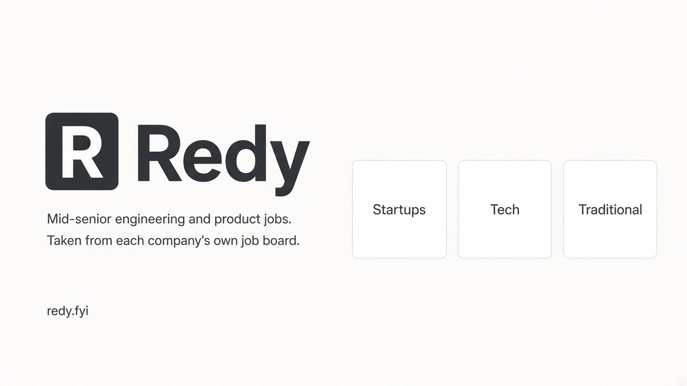

# Redy



**[redy.fyi](https://redy.fyi)** · [source](https://github.com/ZhimingZo/Redy)

Redy is a free job board for **mid-senior and above** engineering and product roles in the United States. Every listing is read from that company's own career site, and the link opens the employer's posting.

## Why it exists

Recent layoffs in tech put a lot of experienced people back on the market at the same time. Redy is a community board for that search. Open engineering and product roles are already in one list, so you can apply and track each application quickly. The hours that used to go to Google stay available for interview preparation.

The list is mid-senior and above, in the United States. Intern, new-grad, and junior titles are left off. Each link opens the posting on the company's own career site.

## Features

### Three tracks

- **Startups.** Companies backed by a16z or Y Combinator that are still private. A company that is already public is not listed here.
- **Tech.** US public technology companies and large US unicorns, including platforms that sit outside a narrow software index.
- **Traditional.** Recognizable US companies in banking, retail, healthcare, and industry.

Search follows the company. Typing a name such as Pinterest on the Startups track moves you to Tech, where that company actually is.

### Finding a role

- Search titles, companies, and skills.
- Level from mid-senior through staff and management. Roles with no stated level can be included or hidden.
- Engineering, product, or both. Specialties such as AI / ML, infrastructure, data, and security are separate chips.
- United States, US remote, or a metro: SF Bay Area, New York, Seattle, Los Angeles, Boston, Austin, Chicago.
- A pay floor, and a filter for roles that publish a range.
- Sort by last update, highest pay, or seniority.
- **Updated** is the last change on the employer's board when that board provides one, not the day Redy first stored the row.
- Copy a link to the exact filters. The address is the view.

### Whether the role is still the same

A listing stays **Open** while it is still on the company board and the description matches the last check. **Changed** means it is still listed and the description was rewritten. A saved role that leaves the board becomes **Closed** in the tracker. The check reads the board's own listing. An HTTP 200 from the career site is not treated as proof that the job is open.

Startups are crawled every hour. Tech and Traditional are rebuilt once a day, and the link check runs after each of those crawls.

### Tracker

Star a role and it stays in this browser. There is no account.

- Move it through Saved, Applied, Recruiter screen, Interviewing, Offer, Rejected, and Withdrawn.
- Keep a one-line note for the next step, a recruiter, or a referral.
- The applied date fills in the day you mark Applied. You can change it.
- A follow-up date brings that role to the top on the day it is due.
- If the posting later closes or the description changes, the saved row shows that status.

## What is on the board

The live site is the current count. As a snapshot while this was published, the board held about 3,800 startup roles, 12,700 tech roles, and 6,600 traditional roles.

Only engineering and product families are stored: software engineering, research engineering, data science work that is a scientist or engineer role, and product management. Sales engineering, recruiting, and analyst titles are not. Locations outside the United States are not.

Research engineer, research scientist, and applied scientist titles are included. A title that also says LLM, VLM, or multimodal lands on the AI / ML chip. Internships and titles marked I or II are not.

## Run it

```bash
pip install -r requirements.txt
python -m pytest -q tests
python -m crawler                                  # startups -> web/data/jobs.json
python -m crawler --refresh tech                   # rebuild the Tech board
python -m crawler --refresh traditional            # rebuild the Traditional board
python -m crawler --monitor                        # recheck listings against the board, not HTTP 200
python -m http.server -d web 8000                  # http://localhost:8000
```

## Deploy

The site is [redy.fyi](https://redy.fyi). It is the `web/` directory on Vercel, with no build step. Pushes that change `web/` redeploy.

GitHub Actions crawls startups hourly (`.github/workflows/crawl.yml`) and refreshes Tech and Traditional daily (`.github/workflows/refresh.yml`). Both commit the data files they change.
